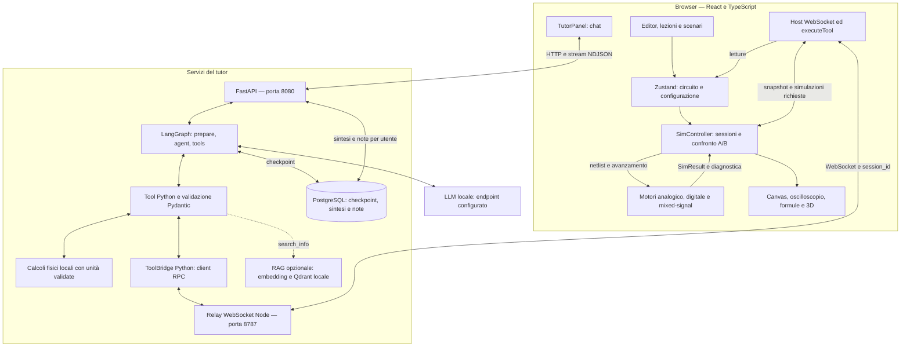
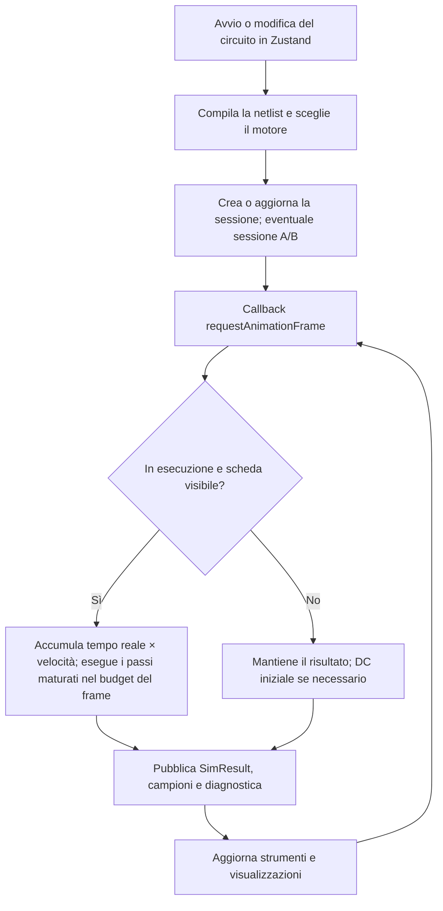
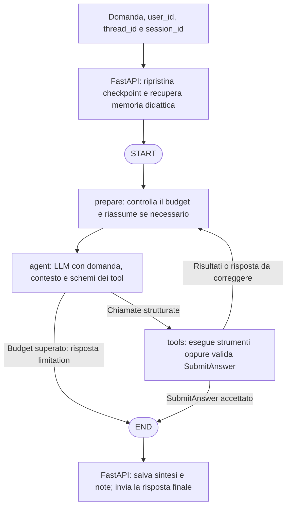

# ⚡ Circuit Studio

Piattaforma didattica per imparare **davvero** l'elettronica — analogica, digitale
e mixed-signal — costruendo e simulando circuiti: modifichi il circuito e vedi la
conseguenza in tempo reale. Il *perché* di un componente non si spiega a parole —
emerge dal **confronto A/B**: lo togli, e la traccia sull'oscilloscopio te lo racconta.

Visione, decisioni bloccate e invarianti architetturali: [`docs/CHARTER.md`](docs/CHARTER.md).
Mappa dei seam: [`docs/SEAMS.md`](docs/SEAMS.md).

## Avvio

```sh
npm install
npm run dev        # app su http://localhost:5173
```

Per il **tutor AI** (opzionale), avvia il modello locale configurato e il
servizio LangGraph. Il default non usa API cloud:

```sh
cp .env.example .env     # configura LLM_BASE_URL e LLM_MODEL
docker compose up -d --wait postgres
cd ai
uv sync --extra dev
uv run python -m circuit_ai   # FastAPI su http://127.0.0.1:8080
```

Il tutor usa LM Studio su `http://127.0.0.1:1235/v1` per default; imposta
`LLM_BASE_URL` se la porta è diversa. Dopo modifiche alla configurazione Python
riavvia il servizio AI.

In un altro terminale, dalla radice: `npm run tool-bridge`. Il browser si
collega automaticamente al relay tramite il proxy WebSocket di Vite. Il tutor
usa un solo percorso LangGraph e decide quando leggere o simulare il circuito;
può rispondere alle domande teoriche anche senza browser collegato.
Schemi Pydantic per tool e risposte, memoria PostgreSQL e riassunti automatici
al superamento della soglia configurata. Provider esterni disponibili solo con
configurazione esplicita server-side.
Configurazione e avvio: [`ai/README.md`](ai/README.md).

## Architettura

La **simulazione vive nel browser**: editor, strumenti, formule e viste leggono
lo stesso circuito e i risultati dei motori TypeScript. Il tutor usa un unico
grafo LangGraph sul servizio Python; il modello sceglie quando rispondere alla
teoria e quando interrogare il circuito live tramite tool.



Il diagramma mostra i collegamenti logici. In sviluppo **Vite** inoltra `/api`
a FastAPI e `/tool-bridge` al relay; in produzione questi inoltri spettano al
reverse proxy. Il relay Node instrada richieste e risposte verso la scheda
browser indicata da `session_id`. I motori nel browser simulano il circuito live;
i tool Python eseguono calcoli didattici sui parametri espliciti. L'LLM sceglie
gli strumenti e spiega il metodo; il server formatta i risultati strutturati.

Il provider predefinito è locale, con protocollo compatibile OpenAI su
`LLM_BASE_URL`. I provider cloud richiedono configurazione esplicita sul server.
Il RAG, quando abilitato, cerca documenti; PostgreSQL conserva il contesto delle
conversazioni e le note didattiche. Memoria e ricerca documentale hanno quindi
compiti distinti.

La verifica offline del tutor separa risultati numerici strutturati e spiegazioni:
confronti numerici nel codice, prove testuali esatte, dichiarazioni scalari con
etichette univoche e classificatore NLI locale
su CPU. Le unità conservano contesto e provenienza; il tokenizer impone il
budget reale e i controlli sugli oggetti impediscono di usare grandezze disgiunte
come prova. Gli esiti incerti restano espliciti. È una diagnostica in corso di validazione, esterna al percorso live;
avvio e limiti sono in [`ai/README.md`](ai/README.md#verifica-con-output-strutturato-e-nli-locale).

| Area | Codice | Responsabilità |
| --- | --- | --- |
| Stato e modifiche | [`src/store/`](src/store/) | Zustand, comandi, undo/redo, ambiente e configurazione della UI. |
| Modello e componenti | [`src/model/`](src/model/), [`src/library/`](src/library/) | Circuito, compilazione dei fili in nodi elettrici, modelli dei dispositivi e formule. |
| Simulazione | [`src/engine/`](src/engine/), [`controller.ts`](src/viz/controller.ts) | Soluzioni numeriche, stato delle sessioni, campioni e confronto A/B. |
| Interfaccia e didattica | [`src/editor/`](src/editor/), [`src/viz/`](src/viz/), [`src/math/`](src/math/), [`src/viz3d/`](src/viz3d/), [`src/lessons/`](src/lessons/), [`src/scenarios/`](src/scenarios/) | Editor, strumenti, visualizzazioni, lezioni e scenari salvabili. |
| Tutor e contratti | [`ai/circuit_ai/api/server.py`](ai/circuit_ai/api/server.py), [`ai/circuit_ai/agent/graph.py`](ai/circuit_ai/agent/graph.py), [`ai/circuit_ai/contracts/shared.py`](ai/circuit_ai/contracts/shared.py), [`ai/circuit_ai/core/config.py`](ai/circuit_ai/core/config.py) | HTTP, orchestrazione, schemi di input/output e configurazione del modello. |
| Collegamento ai tool live | [`src/ai/`](src/ai/), [`tool-bridge.mjs`](server/tool-bridge.mjs), [`tool_bridge.py`](ai/circuit_ai/integrations/bridge.py), [`ai/circuit_ai/tools/catalog.py`](ai/circuit_ai/tools/catalog.py) | Registrazione delle schede, RPC WebSocket, esecuzione browser e validazione dei risultati. |
| Memoria e contesto | [`ai/circuit_ai/memory/postgres.py`](ai/circuit_ai/memory/postgres.py), [`ai/circuit_ai/agent/context.py`](ai/circuit_ai/agent/context.py) | Checkpoint PostgreSQL, note fra conversazioni, budget e riassunti del contesto. |
| Valutazione offline | [`ai/evals/`](ai/evals/), [`ai/circuit_ai/evaluation/runner.py`](ai/circuit_ai/evaluation/runner.py), [`ai/circuit_ai/evaluation/checks.py`](ai/circuit_ai/evaluation/checks.py), [`ai/circuit_ai/evaluation/judge.py`](ai/circuit_ai/evaluation/judge.py), [`ai/circuit_ai/evaluation/calibration.py`](ai/circuit_ai/evaluation/calibration.py) | Dataset, esperimenti ripetibili, controlli deterministici, judge locale e confronto con etichette umane. |

### Flusso della simulazione live



Una **sessione di simulazione** conserva il tempo e gli stati fisici necessari
al passo successivo, come tensioni dei condensatori e correnti degli induttori.
Le modifiche ordinarie trasferiscono gli stati disponibili; il caricamento
integrale di uno scenario riavvia la simulazione. Il confronto A/B usa una
seconda sessione con il circuito modificato.

Il passo numerico e il frame grafico hanno ritmi diversi: il controller può
eseguire più passi per callback e il solver analogico usa sottopassi adattivi.
La velocità predefinita è **1×**: un secondo reale corrisponde a un secondo
simulato, se il calcolo riesce a tenere il ritmo. Il selettore accanto a
Esegui/Pausa offre **0,25×, 0,5×, 1×, 2×, 5× e 10×**, indipendenti da Δt.
Per un clock a **0,1 Hz** ciascun livello High/Low dura cinque secondi a 1×;
nei campi numerici è ammessa anche la virgola decimale (`0,1`).

Il controller mantiene il budget di 8 ms per frame. Se il calcolo è troppo lento,
mostra il ritardo accumulato senza saltare passi fisici. Pausa e scheda in
background sospendono il live; alla ripresa non viene recuperato il tempo della
sospensione. Gli scenari salvano la velocità; quelli precedenti partono a 1×.
Gli strumenti leggono risultati e diagnostica pubblicati dal controller.
`runDC` e `runTransient`, richiesti dal tutor, effettuano analisi dedicate;
la transitoria richiesta via tool usa una sessione separata da quella live.

### Cosa fa il grafo LangGraph

Il grafo coordina **contesto → decisione del modello → tool → risposta
validata**. La stessa implementazione serve la chat del browser e i client
HTTP esterni.



- **`prepare`** compatta la cronologia oltre la soglia configurata, conservando
  il turno corrente e le coppie chiamata/risposta dei tool.
- **`agent`** sceglie gli strumenti oppure conclude con `SubmitAnswer`. Anche
  una spiegazione teorica usa questo schema finale, senza richiedere tool del
  browser.
- **`tools`** esegue le chiamate: letture e simulazioni live passano dal bridge al browser;
  i tool fisici (Ohm, potenza DC/RMS, serie, partitore caricato e sinusoide)
  calcolano in Python con parametri e unità validati;
  `search_info`, se abilitato, consulta i documenti. Per `SubmitAnswer` controlla
  lo schema e la coerenza delle revisioni, costruisce i metadati dalle chiamate
  del turno e aggiunge al testo i valori di `numeric_results`. Il modello scrive
  la spiegazione senza duplicare i numeri.

Gli output del browser sono validati con Pydantic prima di diventare evidenze.
Le misure dichiarate nella risposta richiedono un'evidenza convergente acquisita
nel turno corrente. Se le revisioni cambiano fra letture, il modello deve
concludere con una limitazione. Gli errori dei tool ritornano al modello come
risultati strutturati; round, tentativi di correzione e tempi sono limitati.
Questi controlli verificano contratti e metadati: la correttezza di ogni frase
richiede anche valutazione semantica.

La chat mostra progressivamente gli eventi dei tool e pubblica il testo finale
dopo la validazione. Per domande sul circuito live serve il browser collegato;
teoria e saluti possono essere gestiti anche senza una scheda connessa.

### Identità e memoria

| Identità | Cosa rappresenta |
| --- | --- |
| Sessione numerica (`TransientSession`) | Il calcolo in corso nel browser, con tempo e stati fisici; una seconda sessione sostiene il confronto A/B. |
| `session_id` | La scheda browser cui indirizzare i tool via WebSocket. |
| `thread_id` | La conversazione da riprendere dai checkpoint del grafo. |
| `user_id` | Il contesto utente cui appartengono conversazioni e note didattiche condivise fra thread. |

PostgreSQL usa `AsyncPostgresSaver` per i checkpoint e `AsyncPostgresStore` per
sintesi e note. Le richieste dello stesso utente/thread sono serializzate con
lock PostgreSQL. Quando il contesto cresce, `ConversationSummary` riduce la
cronologia attiva conservandone una sintesi persistente; i vecchi checkpoint
rimangono nel database. Misure e riassunti storici vanno distinti dallo stato
live appena letto.

La valutazione **LLMOps offline** riusa il grafo con fixture controllate e
checkpoint in memoria: verifica prima i contratti, poi usa facoltativamente un
judge locale consultivo e prepara il confronto umano. I voti del judge restano
informativi per default; la calibrazione umana non blocca lo sviluppo.
Questo percorso valuta il tutor
senza richiedere il browser; i report e le annotazioni sono salvati in
`.local-notes/llmops/`, ignorata da Git. Dataset e codice degli evaluator sono
versionati. Configurazione, comandi e criteri: [`ai/README.md`](ai/README.md).
Il dataset [`ai/evals/textbook/`](ai/evals/textbook/) aggiunge 11 casi derivati
da soluzioni pubblicate di elettronica, con fonti e pagine tracciate, separando
prove senza tool e misure su fixture. I libri forniscono le soluzioni attese
agli evaluator, senza retrieval nel percorso del tutor. Serve a costruire la
baseline di confronto; non è ancora una baseline approvata.
Il nuovo [`dataset da 100 record`](ai/evals/baseline/dataset.v1.json) amplia
questa prova con 30 esercizi svolti, 30 circuiti realmente eseguiti con ngspice,
20 domande teoriche e 20 casi alterati, ambigui o difficili. Sono 90 domande per
il tutor e 10 controlli negativi del verificatore, con fonti e famiglie tracciate.
Il runner [`circuit_ai/baseline/runner.py`](ai/circuit_ai/baseline/runner.py) usa il grafo con tool offline
di calcolo e simulazione; NLI specializzato gira su CPU/RAM, direttamente o
su localhost, mentre Gemma resta in LM Studio. Nessun retrieval è richiesto.
Comandi e limiti: [`dataset e ngspice`](ai/README.md#dataset-da-100-record-e-ngspice).
[`ai/circuit_ai/evaluation/probes.py`](ai/circuit_ai/evaluation/probes.py) verifica il judge con risposte corrette
brevi e spiegate e varianti con errori controllati, mantenendo aspettative e
mutazioni nascoste al modello. Questa verifica rimane distinta dalla calibrazione
umana e dall'approvazione della baseline.
Per i controlli numerici il judge usa un calcolatore locale con aritmetica
decimale e verifica delle unità, conservando nel report chiamate e risultati.

## Cosa c'è dentro

### Editor 2D
Griglia SVG: piazza, trascina, **ruota**, **duplica** e **multi-selezione a
rettangolo** con spostamento di gruppo, copia/incolla, undo/redo (command pattern),
salva/carica JSON. **Ricerca nella palette** e **evidenziazione del net** al
passaggio del mouse.
Cablaggio con **gomito invertibile**, **waypoint multipli** (instradamento a più
segmenti) e **giunzioni a T**; i fili seguono i componenti spostati.

### Motori di simulazione (proprietari, MIT, niente GPL)
- **Analogico**: MNA per stamping, Newton-Raphson con gmin stepping e limiting
  delle giunzioni, transitoria backward Euler con sottopassi adattivi, stima dell’errore e rollback dei passi rifiutati. Convergenza verificata con residui e tolleranze separate per tensioni e correnti; diagnostica delle isole flottanti. Validato contro
  riferimenti analitici (`npm test`) e, offline, contro ngspice
  (`npm run validate:spice`).
- **Digitale nativo**: combinatoria a punto fisso + sequenziale sul fronte di
  clock, dietro l'interfaccia `Simulator`.
- **Coordinatore mixed-signal**: co-simula analogico↔digitale nello **stesso
  circuito** accoppiando i due motori ai **nodi di confine** (soglia in ingresso,
  tensione pilotata in uscita). Il controller instrada per dominio.

### Libreria componenti
- **Sorgenti**: DC, sinusoidale (con fase), corrente, pulse.
- **Passivi**: R, C, L, potenziometro.
- **Semiconduttori**: diodo, **LED** (si accende col colore scelto), Schottky,
  Zener, BJT NPN/PNP (Ebers-Moll), MOSFET N/P, op-amp, ponte raddrizzatore,
  trasformatore, relè, fusibile.
- **Sensori** (variabili d'ambiente regolabili): LDR, NTC/PTC, barometro, Hall,
  umidità.
- **Digitale**: ingresso/clock/uscita logica, porte NOT/BUFFER/AND/OR/NAND/NOR/
  XOR/XNOR, flip-flop **D** e **T**, **display esadecimale a 7 segmenti**.
- **Strumenti** piazzabili: **multimetro** (in parallelo, alta impedenza,
  manopola V/R/C/L/diodo) e **amperometro** (in serie, ideale) — quanti ne vuoi,
  con letture live sul canvas.

### Visualizzazione 3D + campi
Pannello **3D** (React Three Fiber, caricato in lazy): il componente selezionato
come modello ruotabile ancorato ai dati vivi (il resistore mostra le sue **bande di
colore reali**, il LED si illumina), con i **campi** animati dalla simulazione:
**flusso di corrente**, **campo E** fra le armature del condensatore, **campo B**
attorno alla bobina.

### Dimensionamento di potenza
Resistenze con potenza nominale configurabile, derating con la temperatura
ambiente e avvisi live sul canvas. Il pannello distingue potenza istantanea,
media e temperatura stimata; il modello termico ha parametri regolabili.
Dati e limiti sono disponibili anche al tutor. Il profilo termico predefinito
è didattico e non simula automaticamente la rottura del componente.

### Analisi e didattica
- **Visualizzazione 2D**: fili colorati per tensione, puntini di corrente animati,
  sonde, oscilloscopio multi-traccia (tempo e **Bode**), **confronto A/B** con
  traccia fantasma (tasto `a`).
- **Pannello matematico** (KaTeX): derivazioni complete con i termini **mappati sui
  valori vivi** — hover sul simbolo → si illumina il componente.
- **Tavola di verità dal vivo** per i circuiti digitali (clic su una riga per
  impostare gli ingressi).
- **Lezioni guidate**, **libreria scenari** (nel browser) e stato completo
  salvabile/condivisibile (file o link), modalità presentazione (← →).
- **Tutor AI ancorato**: chiama i tool (`getNetlist`, `runDC`, …) prima di
  affermare qualsiasi cosa sul circuito; le chiamate sono visibili nel transcript.

## Comandi

| Comando | Cosa fa |
| --- | --- |
| `npm run dev` | dev server Vite |
| `docker compose up -d --wait postgres` | database persistente per il tutor |
| `npm run ai` | servizio tutor FastAPI/LangGraph (default LLM locale) |
| `npm run tool-bridge` | relay WebSocket per i tool live |
| `npm run validate:spice` | confronto automatico con ngspice installato, oppure `NGSPICE_BIN` |
| `npm test` | test del motore (`node --test`, validazione analitica) |
| `npm run test:e2e` | e2e Playwright |
| `npm run build` | typecheck + build di produzione |

## Scorciatoie

`w` filo · `p` sonda · `r` ruota · `a` confronto A/B · `Canc` cancella ·
`Ctrl+Z`/`Ctrl+Y` undo/redo · `Ctrl+C`/`Ctrl+V`/`Ctrl+D` copia/incolla/duplica ·
`Esc` seleziona · trascinamento su area vuota = selezione a rettangolo,
`Spazio`+trascinamento (o tasto centrale) = pan · doppio click su interruttore/
ingresso logico = commuta · doppio click su un filo = inverte il gomito ·
`←`/`→` passi lezione.

Filo: clic sul pin di partenza, clic nel vuoto per aggiungere waypoint, clic sul
pin d'arrivo per chiudere; clic su un filo esistente per creare una giunzione.

## Licenza

MIT — vedi [`LICENSE`](LICENSE).
