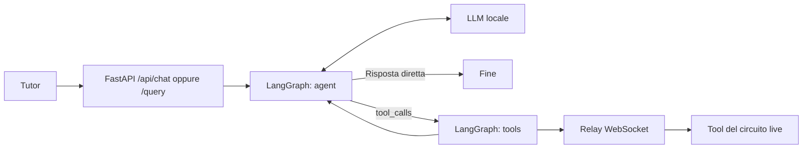

# Tutor unificato LangGraph

Il tutor React e i client esterni usano lo stesso grafo. Il default è un LLM
locale con endpoint compatibile OpenAI e supporto tool calling. L'uso della
classe `ChatOpenAI` è un adattatore di protocollo: con `LLM_PROVIDER=local` le
richieste vanno esclusivamente a `LLM_BASE_URL`, senza fallback al cloud.

## Avvio

Dalla radice del repository:

```sh
cp .env.example .env
cd ai
uv sync --extra dev
uv run python main.py
```

In altri due terminali, dalla radice:

```sh
npm run tool-bridge
npm run dev
```

Avvia il modello locale configurato in `.env` (default `127.0.0.1:1234/v1`).
`npm run ai` è un alias per avviare il servizio Python. Vite inoltra `/api`
a FastAPI sulla porta 8080 e `/tool-bridge` al relay WS sulla porta 8787.
In produzione occorre configurare gli stessi inoltri nel reverse proxy.

Il browser si collega al bridge automaticamente. Le risposte teoriche non
richiedono il browser; per leggere o simulare il circuito live servono browser
e relay collegati. Nessuna chiamata a LLM o documenti avviene all'import dei moduli.



La domanda originale viene mantenuta, insieme a risposte e ToolMessage. La
memoria dei thread è salvata in `ai/data/checkpoints.db` (directory stabile,
configurabile con `AI_DATA_DIR`). Il grafo non traduce automaticamente in inglese.
Gli errori dei tool vengono restituiti al modello e mostrati nel transcript.
Il ciclo è limitato a otto round di tool; poi il modello deve concludere.

## HTTP

`POST /api/chat` e `POST /query` accettano lo stesso corpo:

```json
{"query": "Perché il LED non si accende?", "thread_id": "mia-conversazione"}
```

La risposta contiene `response`, `thread_id`, `tools` (traccia delle chiamate)
e `snapshot_revision`. Il tutor mostra un avviso se il circuito è cambiato
mentre il modello elaborava i dati. `GET /healthz` restituisce stato, provider e
modello configurati. Uno stesso `thread_id` serializza le richieste nello stesso
processo; il relay corrente supporta un solo browser host e non fa routing multiutente.

## Provider e RAG facoltativi

`LLM_PROVIDER=openai` richiede `OPENAI_API_KEY` e `LLM_MODEL`.
`LLM_PROVIDER=anthropic` richiede `uv sync --extra anthropic`,
`ANTHROPIC_API_KEY` e `LLM_MODEL`. `LLM_BASE_URL`, se impostata, sostituisce
l'endpoint del provider. Non esistono credenziali nel frontend.
Per conservare gli extra nella sincronizzazione di avvio puoi usare
`uv run --extra anthropic python main.py` o `uv run --extra rag python main.py`.

Il RAG è disabilitato per default e non serve alla chat o ai tool del circuito.
Per abilitarlo: `uv sync --extra rag` e `RAG_ENABLED=true`. `search_info`
apre Qdrant e il modello embedding solo quando viene effettivamente chiamato.
La collezione `electronics`, nella directory `AI_DATA_DIR/qdrant`, deve essere
indicizzata separatamente con i moduli `chunking` e `vectorstore`.

## Verifica

```sh
uv run --extra dev python -m unittest discover -s tests -v
```

I test usano modelli deterministici e un server WebSocket locale: non richiedono
un LLM avviato o credenziali cloud.
