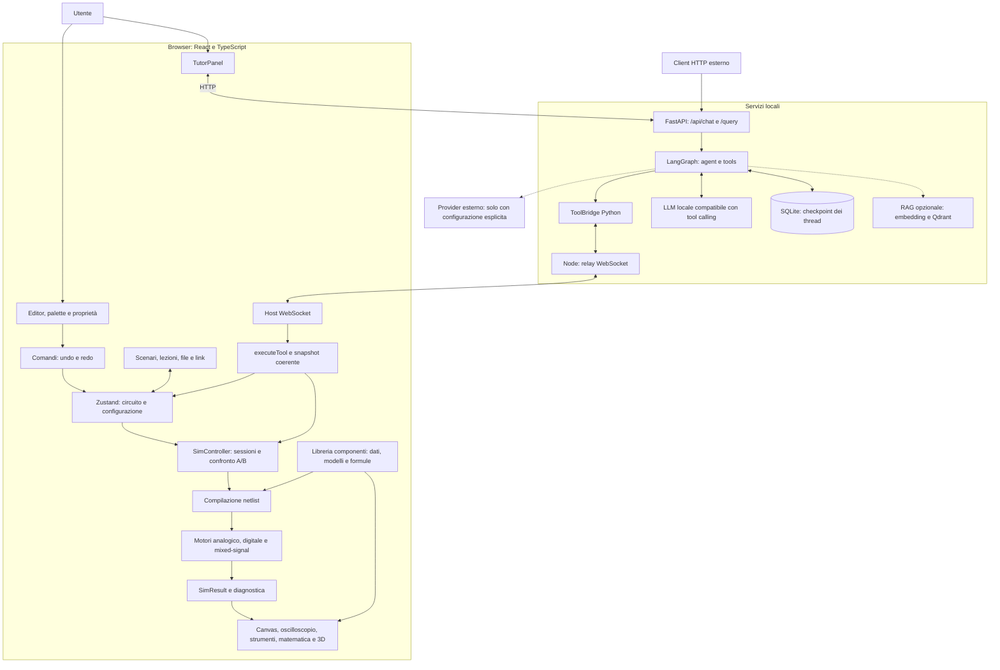
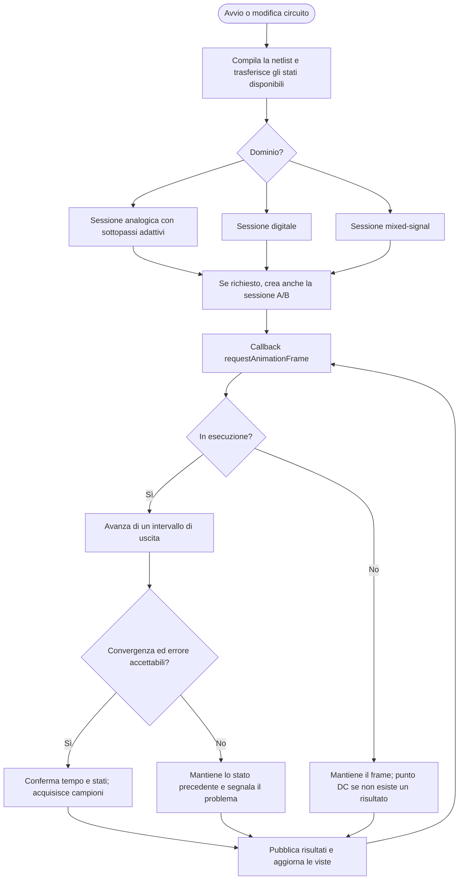
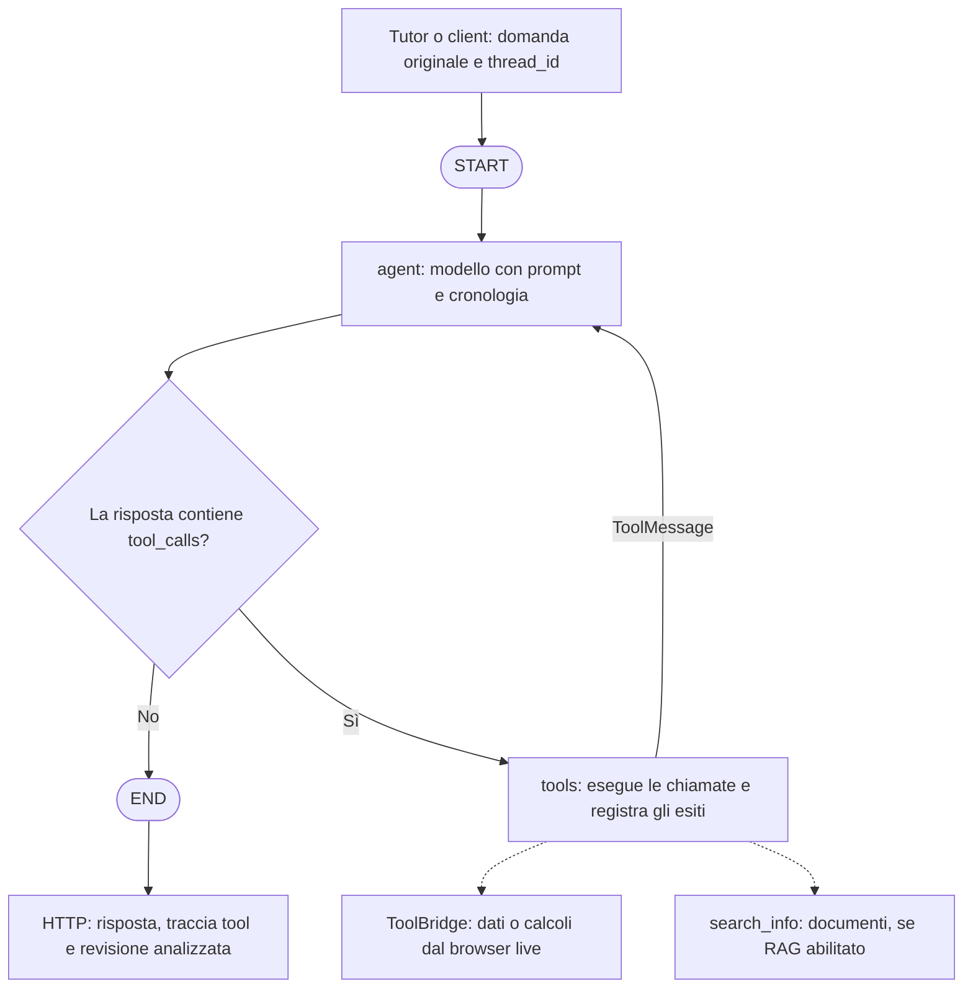
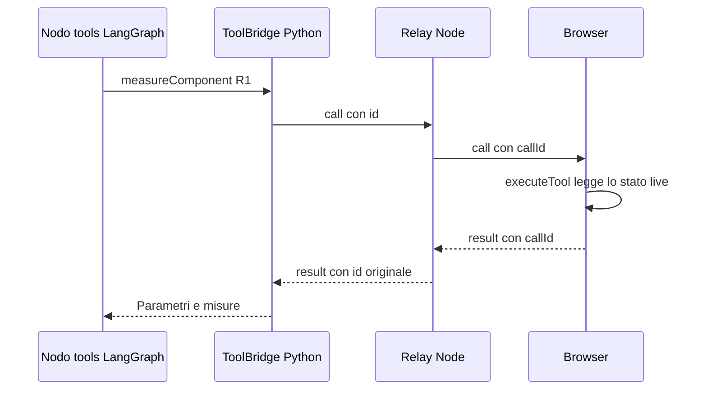

# Circuit Studio: architettura, flussi e concetti

Aggiornato il 16 ottobre 2026 dopo l'unificazione del tutor e i miglioramenti
numerici di priorità 1. Questa versione sostituisce la descrizione iniziale
con due percorsi AI separati.

## Architettura attuale

La simulazione resta nel browser e la modalità live è il comportamento centrale.
Il tutor React e i client esterni usano lo stesso servizio FastAPI/LangGraph.
Il modello predefinito è locale: nessuna richiesta cloud o fallback automatico.

Vite inoltra `/api` a FastAPI (porta 8080) e `/tool-bridge` al relay (8787).
In produzione gli stessi inoltri vanno configurati nel reverse proxy.
Il precedente `server/proxy.mjs` e il loop Claude nel frontend sono stati rimossi.

| Area | File | Responsabilità |
| --- | --- | --- |
| Avvio | `src/main.tsx` | Registra i componenti, recupera lo scenario dal link, collega il bridge e avvia UI e simulazione. |
| Stato e modifiche | `src/store/studio.ts`, `src/store/commands.ts` | Circuito, configurazione, comandi reversibili, undo/redo. |
| Modello | `src/model/*`, `src/library/*` | Componenti, pin, fili, compilazione dei nodi elettrici e contributi alle equazioni. |
| Simulazione | `src/engine/*`, `src/viz/controller.ts` | Solver, sessioni, campioni, risultati e confronto A/B. |
| Viste | `src/viz/*`, `src/math/*`, `src/viz3d/*` | Grafici, misure, formule e modelli 3D alimentati dalla simulazione. |
| Didattica | `src/lessons/*`, `src/scenarios/*` | Lezioni, configurazioni salvate e condivise. |
| Tutor | `src/ai/TutorPanel.tsx`, `ai/main.py`, `ai/graph.py`, `ai/config.py` | Chat HTTP, memoria e decisione fra risposta diretta e tool. |
| Tool live | `src/ai/tools.ts`, `src/ai/toolBridge.ts`, `server/tool-bridge.mjs`, `ai/modules/tool_bridge.py` | Lettura e simulazioni richieste da Python al browser. |

## Flusso della simulazione

Il controller esegue più passi nel budget di circa 8 ms per callback; un singolo
passo costoso può superarlo. Gli aggiornamenti React tramite `useSimTick` sono
limitati a circa uno ogni 60 ms. Campioni e frame non coincidono necessariamente.

La griglia di uscita rimane costante: un `step()` avanza di `dt` secondi simulati,
ma il solver analogico può usare molti sottopassi interni più piccoli. Questo
mantiene allineati tempo della sessione, A/B e coordinamento con il digitale.

## Flusso del tutor e LangGraph

I nodi registrati sono `agent` e `tools`; la funzione di routing seleziona il
nodo tool oppure la fine. L'agente può rispondere direttamente a teoria, saluti
e domande generali. Il prompt richiede dati acquisiti nel turno corrente prima
di affermare fatti sul circuito aperto. Questo vincolo è espresso nel prompt;
non è un verificatore formale delle affermazioni prodotte dal modello.

Non c'è più traduzione obbligatoria in inglese né acquisizione preventiva di
ogni componente. Il modello può scegliere `getCircuitSnapshot`, misure mirate,
`runDC`, `runTransient`, informazioni sulle lezioni o sulla libreria.

Gli errori dei tool diventano `ToolMessage` con stato d'errore. Il modello può
spiegarli e fornire teoria senza inventare misure. Dopo otto round di tool si
richiede una conclusione senza nuovi strumenti. Richieste HTTP e RPC hanno
timeout; un turno interrotto viene riparato prima del turno successivo se lascia
chiamate tool pendenti nel checkpoint.

### Memoria e configurazione

Lo stato del grafo contiene `messages`, `tool_rounds`, `trace` e
`snapshot_revision`. `add_messages` conserva anche le domande originali.
FastAPI restituisce `response`, `thread_id`, `tools` e `snapshot_revision`.
Le richieste dello stesso thread sono serializzate nel processo.

SQLite conserva i checkpoint in `ai/data/checkpoints.db`, configurabile con
`AI_DATA_DIR`. Non è previsto uno store separato di memoria a lungo termine.
Un `thread_id` separa le conversazioni, non seleziona un diverso browser.
Il relay attuale mantiene un solo host: non è un servizio multiutente.

Default: `LLM_PROVIDER=local`, `LLM_BASE_URL=http://127.0.0.1:1234/v1` e
`LLM_MODEL=google/gemma-4-e4b`. Il modello deve essere avviato separatamente e
supportare tool calling. `ChatOpenAI` è usato come adattatore del protocollo;
con il provider locale non contatta il servizio OpenAI. Provider `openai` e
`anthropic` sono opzioni esplicite con modello e credenziali sul server.

Il RAG è opzionale e disabilitato per default. Con `RAG_ENABLED=true` e l'extra
Python `rag`, il tool `search_info` carica il modello embedding e Qdrant soltanto
alla prima ricerca. La collezione `electronics` deve essere già indicizzata
in `AI_DATA_DIR/qdrant`. L'indicizzazione automatica non fa parte della chat.

## Glossario con esempi

### Sessione

Una sessione di simulazione è un calcolo che conserva memoria fisica. Contiene
il tempo, il circuito compilato, la configurazione del passo e gli stati
necessari a continuare: tensioni dei condensatori, correnti degli induttori,
stati dei componenti sequenziali e ultima soluzione numerica.

Se il condensatore è a 3 V, il passo successivo parte da quella condizione.
`session.step()` fa avanzare la simulazione; `session.states()` restituisce una
copia degli stati. Dopo una modifica il controller li trasferisce alla nuova
sessione dove possibile. Per A/B esistono due sessioni.

Un caricamento integrale (lezione, file o scenario) riparte invece da tempo
zero e dagli stati iniziali. Undo/redo di un caricamento riavvia la simulazione;
le normali modifiche di componenti conservano la continuità. Un circuito vuoto
non fa avanzare il tempo. Questo evita avvii arbitrari a metà sinusoide quando
si apre una lezione.

La sessione numerica è diversa dalla conversazione LangGraph identificata da
`thread_id` e dalla configurazione salvata in uno scenario.

### Frame, requestAnimationFrame e re-render

Nel codice non esiste una funzione denominata `reframe`.

| Termine | Significato |
| --- | --- |
| Passo numerico | Calcolo della soluzione a un tempo successivo. |
| Frame grafico | Occasione di aggiornamento visivo del browser. |
| `requestAnimationFrame` | Programma una callback prima di un successivo ridisegno. |
| `SimFrame` | Pacchetto con circuito compilato, ultimo risultato e risultato A/B opzionale. |
| Re-render | React ricalcola la rappresentazione dell'interfaccia dopo un cambiamento osservato. |

Tempo reale e simulato non sono legati in rapporto 1:1: la macchina può
calcolare un diverso numero di passi per callback. Le schede in background
possono sospendere `requestAnimationFrame`. Il browser aperto non garantisce
avanzamento continuo quando la scheda è nascosta.
[Documentazione MDN](https://developer.mozilla.org/en-US/docs/Web/API/Window/requestAnimationFrame).

### Zustand

È il contenitore condiviso in memoria per circuito e configurazione. Una
modifica alla resistenza aggiorna lo store; il controller riceve la notifica,
aggiorna la sessione e le viste leggono i risultati. Zustand non calcola
l'elettronica né salva automaticamente su disco. I risultati dettagliati
rimangono soprattutto nel controller.
[Documentazione Zustand](https://zustand.docs.pmnd.rs/learn/getting-started/introduction).

### Proxy, WebSocket e tool bridge

Un proxy inoltra richieste. Il proxy HTTP del tutor è ora l'inoltro Vite verso
FastAPI: non contiene un percorso separato verso Claude. Il servizio Python
si occupa del modello e delle eventuali credenziali.

Il WebSocket è il canale persistente bidirezionale. Il tool bridge è il
protocollo applicativo sopra quel canale: nomi delle funzioni, argomenti,
identificatori per abbinare richieste e risposte, risultati ed errori.
[Documentazione MDN](https://developer.mozilla.org/en-US/docs/Web/API/WebSockets_API).

`getNetlist` e `measureComponent` leggono dati disponibili. `runDC` e
`runTransient` avviano calcoli dedicati. Il relay inoltra e non simula.
La connessione live è a richiesta: non trasmette tutti i frame al grafo.

Le transitorie dedicate hanno un budget di circa 250 ms fra i passi pubblici,
per contenere il blocco dell'interfaccia. Un singolo passo costoso può superarlo.
Se non viene raggiunta la durata richiesta, il tool restituisce `truncated=true`
e `actualDuration_s`: il modello deve dichiarare questo limite.

LangGraph descrive il processo dell'assistente; NetworkX descrive invece le
connessioni elettriche contenute nello snapshot. La fisica è calcolata dai
motori TypeScript. Il grafo AI suggerisce modifiche, senza applicarle.

## Miglioramenti numerici di priorità 1

### Passo adattivo

Il solver confronta un passo backward Euler con due mezzi passi. Lo scarto
normalizzato fra le soluzioni stima l'errore locale. Se supera la soglia o
Newton non converge, il passo viene dimezzato e ritentato. Un passo accettato
usa la soluzione dei due mezzi passi e può aumentare il passo successivo.

Tolleranze predefinite dell'errore locale: `1e-7 V`, `1e-10 A`, relativa `2e-5`.
Non sono una garanzia sull'errore globale né sull'accuratezza fisica del modello.
Le sorgenti periodiche analogiche limitano anche il passo interno per ridurre
l'aliasing. Gli stati discreti sono aggiornati dopo l'accettazione, evitando
che un cambiamento di latch venga scambiato per errore di integrazione.

L'intervallo pubblico è atomico: se il numero massimo di tentativi o il passo
minimo impedisce di completarlo, tempo e stati restano quelli precedenti.
`adaptive: false` mantiene il passo fisso per confronti e validazione.

### Convergenza e diagnostica

Newton usa tolleranze distinte: `1e-7 V`, `1e-10 A`, relativa `1e-5`. Prima di
accettare una soluzione il solver ricostruisce le equazioni al candidato e
controlla i residui normalizzati: correnti per KCL e tensioni per i vincoli.
Il residuo deve essere <= 1. Il limiting delle giunzioni e gmin stepping restano.

`SimResult.diagnostics` espone iterate, residuo, sottopassi accettati/rifiutati,
passo interno minimo/massimo, stima dell'errore e possibili nodi flottanti.
La diagnosi delle isole è topologica e conservativa: non sostituisce una prova
di rango o il modello elettrico di ogni dispositivo. Gli avvisi sono accessibili
anche passando sullo stato della simulazione nella toolbar e tramite i tool.

### Validazione automatica

`npm test` comprende sweep analitici di partitori, RC e RL, controlli di residui,
passi rifiutati e diagnostica delle isole, oltre ai test preesistenti.
`npm run validate:spice` confronta automaticamente 12 casi con ngspice esterno:
3 partitori, 3 RC, 3 RL e 3 polarizzazioni di un diodo. L'eseguibile può essere
specificato con `NGSPICE_BIN`. Se manca, il comando termina esplicitamente con
errore; ngspice non entra nel bundle del prodotto.

Nel confronto eseguito con ngspice 45.2: scarto relativo sui partitori inferiore
a 0.0001%, sulle tensioni del diodo inferiore a 0.00004%, RC circa 0.0835%,
RL circa 0.1435%. Sono risultati dei casi e parametri verificati, non di ogni
circuito. Le tolleranze dei confronti sono 0.002%, 0.1% e 0.3% rispettivamente
per partitori, diodi e transitorie.

## Live e analisi di dati salvati

`getCircuitSnapshot` acquisisce sincronicamente netlist e misure del frame,
con revisione, tempo, convergenza e diagnostica. Le modifiche invalidano il
frame precedente. Se non c'è un frame, il tool dichiara le misure indisponibili.
La risposta AI è associata all'ultima revisione letta; il tutor segnala se
il circuito è cambiato durante l'elaborazione.

L'analisi del grafo può procedere mentre la simulazione continua: asincrono e
live sono compatibili. Si potrebbe aggiungere anche l'analisi di snapshot
salvati senza browser; quel percorso non è ancora implementato. Per riprendere
la simulazione servono anche tempo e stati dinamici. Lo scenario JSON attuale
salva la configurazione ma non un checkpoint fisico completo.

## Limiti e sviluppi successivi

- I modelli fisici sono didattici: la precisione del solver non aggiunge
  capacità parassite o fenomeni assenti dai modelli.
- Il digitale resta campionato; il coordinatore misto legge l'analogico del
  passo precedente. La localizzazione completa degli eventi è un intervento
  successivo, distinto dai sottopassi adattivi analogici.
- Il Bode usa ancora transitorie, 40 campioni per periodo e ricerca dei picchi;
  rimane da introdurre l'analisi AC a piccolo segnale.
- Backward Euler rimane il metodo di integrazione: trapezio e Gear/BDF2 sono
  alternative future, da validare e selezionare in base al circuito.
- Worker e matrici sparse potranno migliorare reattività e scalabilità. Non
  sostituiscono i controlli sull'errore e non eliminano la dipendenza dal browser.
- Un modello locale deve supportare correttamente i messaggi tool; non viene
  sostituito automaticamente con un provider cloud in caso di errore.

Avvio, configurazione provider e test Python: [`ai/README.md`](../ai/README.md).
Protocollo live: [`TOOL-BRIDGE.md`](TOOL-BRIDGE.md).
Validazione: [`VALIDATION.md`](VALIDATION.md).
